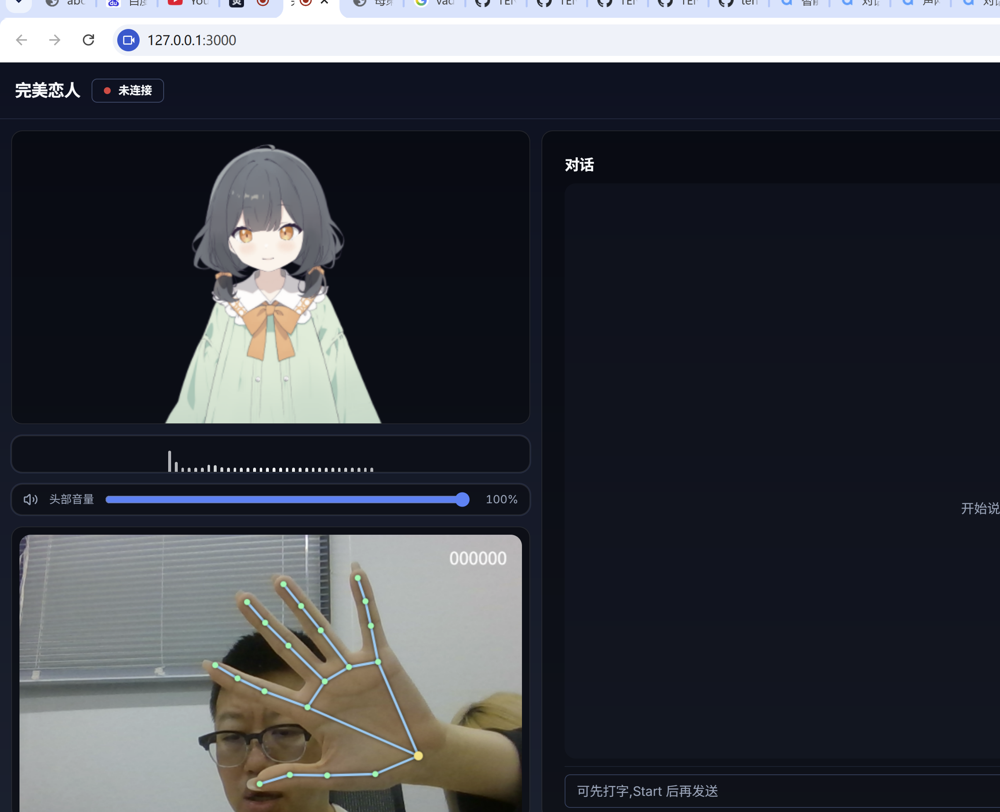
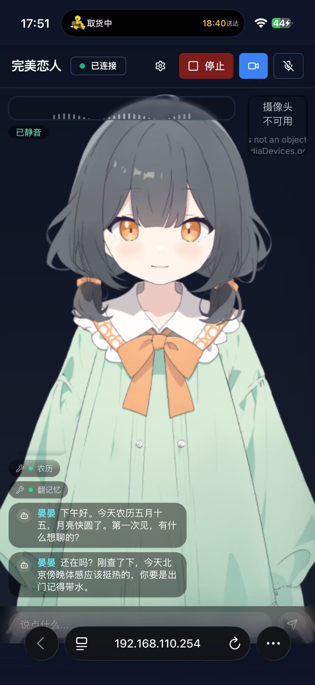

# AI-Lover 同事/客户使用说明

版本：2.0.1

仓库地址：[https://github.com/HBC-Tech-coder/AI-Lover](https://github.com/HBC-Tech-coder/AI-Lover)

## 1. 先拿哪个压缩包

给新电脑或客户电脑使用时，请发送完整包：

```text
dist-customer\AI-Lover-2.0.1-dev-sync-win64.zip
```

这个包里已经包含：

- `AI-Lover.exe` 一键启动器
- 前端网页和本地服务
- Node.js、Python、ADB、手势识别 Python 环境
- 头部 bridge、机械手 bridge
- 文档和示例配置

如果客户已经装过同版本运行环境，只需要替换代码和页面，可以发送热更新包：

```text
dist-customer\AI-Lover-2.0.1-hot-update.zip
```

## 2. 解压和启动

1. 右键 zip，选择“全部解压”。
2. 不要只复制 `AI-Lover.exe`，必须保留整个文件夹。
3. 双击解压目录里的 `AI-Lover.exe`。
4. 等 10-30 秒，浏览器会自动打开：

```text
http://127.0.0.1:3000/
```

5. 网页右上角点“开始”，进入对话。



## 3. 连接硅胶头机械芯

电脑和头部必须在同一个局域网。头部 IP 可以在网页右上角“设置”里修改，也可以修改：

```text
app\customer_config.ps1
```

常用测试页：

```text
http://127.0.0.1:3000/head-control
```

测试顺序建议：

1. 打开 `/head-control`。
2. 确认“控制端点”为 `http://127.0.0.1:8787`。
3. 点击“启动/重连头部桥接”。
4. 点击“检测”。
5. 点击“测试音箱”，确认头部喇叭有声音。
6. 点击“测试麦克风”，确认能采集到音频、音量数值和波形图；如果没有波形，优先排查头部麦克风、ADB 连接和声卡路由。
7. 测试“微笑、伤心、鬼脸、眨眼、转头、舵机”等动作。

如果测试音箱有声音，但对话时选中“头部喇叭”没有声音，请检查首页左侧“头部音量”是否为 0，并查看：

```text
%LOCALAPPDATA%\AI-Lover\local_logs
```

## 4. 头部音量和语音指令

首页左侧有“头部音量”滑杆。也可以直接对智能体说：

- “小声点”
- “大声点”
- “声音小一点”
- “音量调高一点”

当前规则：

1. 智能体先用原音量回复“好的”。
2. 再按原音量 20% 的梯度增大或减小。
3. 如果原来小于 20%，再要求小声，会改为刚刚音量的 50%。
4. 如果原来大于 80%，再要求大声，会改为 100%。
5. 改好后，智能体会用新音量主动问：“我现在的声音大小可以吗？”

## 5. 连接 Arduino 手和 ORCA 手

机械手测试页：

```text
http://127.0.0.1:3000/hand-control
```

这个页面可以做三类测试：

- Arduino 手：选择 COM 口，发送六位手指动作。
- Arduino 演示/演奏：可以运行原始演示动作序列，也可以用宫商角徵羽模式演奏《沧海一声笑》。
- ORCA 手：选择 Dynamixel/ORCA COM 口，使用 17 个关节滑杆单独测试。
- 手势切片：打开摄像头显示骨架，录制手部关键点数据，导入回放，不保存视频。

建议测试顺序：

1. 打开 `/hand-control`。
2. 点击“检测”，先看串口提示。
3. 页面会把 `CH340/WCH/Arduino/CP210/FTDI` 等串口提示为“可能是 Arduino 手”。
4. 页面会把 `Dynamixel/U2D2/Robotis/ORCA` 等串口提示为“可能是 ORCA / Dynamixel”。
5. 只测试识别时打开 `Dry-run`。
6. 要真实控制机械手时关闭 `Dry-run`。
7. Arduino 手先点“张开、握拳、食指”等动作。
8. Arduino 手再点“演示模式”和“演奏”，确认自动动作和演奏模式可用。
9. ORCA 手先用 17 关节滑杆逐个小幅测试，再开启手势跟随。

## 6. 手势骨架、动作切片和粒子效果

首页摄像头区域会叠加手部骨架。设置里可以开启“比心粒子特效”。

当前效果：

- 单手比心：飘出爱心。
- 双手比心：飘出爱心，并从屏幕上方落下铜钱。
- 张开手掌：出现闪光粒子。
- 握拳：出现脉冲光环。

如果关闭手势识别或关闭粒子效果，程序会停止手势 bridge，并向机械手发送张开/停止状态，避免粒子和模仿一直运行。

## 7. 手机、Mac、其他电脑访问

本机使用：

```text
http://127.0.0.1:3000/
```

同一局域网里的手机、Mac、其他电脑访问时，请使用 HTTPS：

```text
https://本机局域网IP:3443/
```

例如：

```text
https://192.168.110.254:3443/
```

注意：局域网访问如果使用普通 `http://192.168.x.x:3000/`，苹果电脑和手机经常会禁止摄像头和麦克风，页面会提示 `navigator.mediaDevices.getUserMedia` 不存在。请改用 HTTPS 地址。



## 8. 画面交换和眼球追踪

横屏桌面模式：

- 双击左上数字人画面，数字人会切到右侧大画面。
- 双击左下摄像头画面，摄像头会切到右侧大画面。
- 双击右侧大画面，返回对话画面。

竖屏手机模式：

- 点击右上角小窗或主画面，可以在数字人和摄像头之间交换大小画面。

外部摄像头眼球追踪：

1. 打开“设置”。
2. 在“硅胶头机械芯”里开启“眼球追踪外部摄像头中的人脸”。
3. 如方向反了，开启“眼球追踪反向”。
4. 如希望头部脖子也跟随较大角度，可开启“脖子跟随大幅度方向”。

说明：头部内部没有摄像头，所以追踪来源是电脑或外接摄像头。浏览器不支持 FaceDetector 时，页面仍可对话，只是不会自动追踪眼球。

## 9. 热更新包怎么用

热更新包路径：

```text
dist-customer\AI-Lover-2.0.1-hot-update.zip
```

使用方式：

1. 先关闭 AI-Lover。
2. 解压热更新包。
3. 把热更新包里的 `app` 文件夹覆盖到客户原来的 AI-Lover 目录。
4. 重新双击 `AI-Lover.exe`。

新电脑不要用热更新包，必须用完整包。

## 10. 常见问题

### 网页打不开

先双击 `Stop_AI-Lover.bat`，再重新双击 `AI-Lover.exe`。仍然打不开时，把启动窗口截图发给技术支持。

### 开始对话失败

确认云端服务可以访问：

```text
http://47.95.119.182:8080
```

### 头部能动但不发声

检查头部音量不是 0，确认 `/head-control` 的“测试音箱”能发声。仍然无声时，把 `local_logs` 发给技术支持。

### Arduino 手不动

确认 `Dry-run` 已关闭，串口选中的是 Arduino 对应的 COM，机械手通电，Arduino 固件按行读取 6 位 pattern。

### ORCA 手不动

确认 `Dry-run` 已关闭，ORCA/Dynamixel 串口正确，手部通电且扭矩开启。先在 `/hand-control` 用 ORCA 17 关节滑杆逐个小幅测试。

## 11. 需要发给技术支持的信息

- 启动窗口截图
- 网页错误截图
- 头部 IP
- Arduino/ORCA 串口号
- `%LOCALAPPDATA%\AI-Lover\local_logs` 里的日志文件
