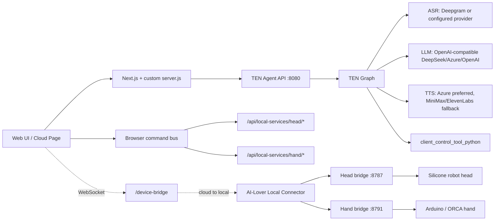

# AI-Lover Project Brief for AI Tasks

本文档给 Codex、Claude、同事和后续任务快速了解当前 AI-Lover 项目。它不是客户使用手册，而是工程交接说明：项目做什么、方向是什么、如何实现、各功能接口在哪里。

最后更新：2026-07-27  
当前仓库版本：`2.0.4`

## 一句话定位

AI-Lover 是基于 TEN-framework 改造的实时语音对话智能体。当前产品方向是：

- 云端提供 AI 对话、Web 页面、角色和数字人能力。
- 客户本地运行 Local Connector，连接局域网或 USB 上的硅胶头、Arduino 手、ORCA 手、摄像头和麦克风。
- 前端统一通过 command bus 驱动“说话、表情、头部动作、手部动作、特效、设置变更”。
- 以后继续扩展 Live2D/Cubism 自动化、GPU 数字人、多平台客户端和说话人分离。

核心结论：云端网页不能直接访问用户内网的 `192.168.x.x` 设备，必须通过客户电脑上的 Local Connector 转发到本地 bridge。

## 仓库和环境

| 项 | 值 |
| --- | --- |
| 本地仓库 | `C:\Users\sunat\xiaoling_local_dev\AI-Lover` |
| GitHub | `https://github.com/HBC-Tech-coder/AI-Lover` |
| 生产域名 | `https://ai.vituralmodel.com` |
| 服务器 | `linux-consolidation-20260703` |
| 服务器当前目录 | `/data/apps/ai-lover-2.0/current` |
| 服务器公网 IP | `39.105.17.219` |
| 旧服务器 | `47.95.119.182`，不要再用于 2.0 部署 |
| 协作记录 | `D:\aishare` |

服务器操作前后都要在 `D:\aishare` 写清楚变更，避免多个 AI 任务互相覆盖。

## 产品方向

### 当前稳定交付

- Web 端实时语音和文字对话。
- Live2D 数字人展示和角色切换。
- 硅胶头机械芯控制：嘴、眼皮、眼球、脖子、表情、头部喇叭、头部麦克风。
- Arduino 手和 ORCA 17 舵机手控制。
- 手势识别、骨架叠加、粒子特效、演奏模式、动作切片录制和回放。
- Local Connector 云端连接和本地离线控制台。
- Windows/macOS Local Connector 包和 Windows 客户完整包。

### 近期方向

- 让客户第一次打开云端网页时，通过“连接本地设备向导”下载并运行 Local Connector。
- 用 command bus 让用户自然语言控制硬件，例如“小声点”“做个鬼脸”“张开手”“切换英文”。
- 接入 TEN diarization 和 turn detection，实现说话人分离、轮次判断、看向说话人。
- 优先让生产 TEN graph 稳定启动，避免默认启用没有运行的 MCP 工具节点。

### 中长期方向

- Live2D 模型生产线：照片预处理、人物分层、PSD/图层包、Cubism Editor 自动化、模板 rig、导出 `.moc3 + model3.json`。
- GPU 数字人 worker：在本地 8GB 显存设备上做更真实的照片数字人和口型驱动。
- 多平台客户端：Web、Windows、macOS，后续 Android/iOS。
- 远程管理：客户本地 connector 上报设备状态、日志和诊断结果，减少人工远程排障。

## 总体架构



本地开发和客户包通常同时运行：

- 前端：`http://127.0.0.1:3000`
- 局域网 HTTPS：`https://<电脑局域网IP>:3443`
- 头部 bridge：`http://127.0.0.1:8787`
- 手部 bridge：`http://127.0.0.1:8791`
- Live2D worker：`http://127.0.0.1:8790`
- TEN agent API：`http://127.0.0.1:8080` 或云端 `AGENT_SERVER_URL`

## 主要目录

| 路径 | 作用 |
| --- | --- |
| `frontend/` | Next.js 前端、页面、API route、自定义 server、Local Connector cloud bridge |
| `frontend/src/app/` | 页面和 Next API routes |
| `frontend/src/lib/` | Live2D、头部控制、手势控制、command bus、角色等前端逻辑 |
| `frontend/public/` | Live2D 模型、生成资源、静态下载文件 |
| `hardware/` | 头部 bridge、手势/机械手 bridge、协议代码 |
| `tools/local-connector/` | AI-Lover Local Connector 和 Windows/macOS 启动脚本 |
| `workers/live2d_worker/` | 本地 Live2D 生成 worker |
| `tenapp/` | TEN app 配置和 graph/property 文件 |
| `scripts/` | 打包、热更新、部署、密钥检查等脚本 |
| `docs/` | 工程和客户文档 |

## 页面功能

| 路由 | 用途 |
| --- | --- |
| `/` | 主对话页：数字人、对话、摄像头、手势、设置、Local Connector 向导 |
| `/head-control` | 硅胶头测试台：检测、重连、表情、舵机、麦克风、喇叭 |
| `/hand-control` | 机械手测试台：串口检测、Arduino/ORCA 测试、动作切片 |
| `/local-control` | Local Connector 本地离线控制台，不依赖公网 AI 对话 |
| `/second-screen` | 第二屏展示页，用于高清摄像头/互动特效大屏 |
| `/characters` | 角色管理：上传 Live2D、设置头像、性别、人设、公开/私有 |
| `/live2d-generate` | 照片到 Live2D 图层包/PSD/Cubism 流程测试 |
| `/photo-avatar-test` | 单张照片说话测试 |
| `/heygen-test` | HeyGen 测试页 |
| `/trulience-test` | Trulience 测试页 |
| `/admin` | 管理相关页面目录，具体能力以代码为准 |
| `/data` | 数据统计相关页面目录，具体能力以代码为准 |

## TEN 语音对话链路

生产 2.0 的 TEN graph 应保持精简，默认只跑核心语音助手：

- `websocket_server`
- `deepgram_asr_python`
- `openai_llm2_python`
- `azure_tts_python`
- `main_python`
- `client_control_tool_python`

不要默认打开没有运行的 MCP SSE 工具节点。否则即使核心对话可以工作，graph 也会因工具节点连接失败而启动失败。

### 前端代理接口

| 接口 | 方法 | 说明 |
| --- | --- | --- |
| `/api/agents/start` | `POST` | 代理到 `AGENT_SERVER_URL/start`，启动 TEN session |
| `/api/agents/ping` | `POST` | 代理到 agent ping，检测 session 或后端状态 |
| `/api/agents/stop` | `POST` | 代理到 agent stop，停止 session |

`AGENT_SERVER_URL` 默认是 `http://localhost:8080`。生产环境通过服务端环境变量指向云端 agent API。

常见 `/start` 请求内容由前端生成，包含 `request_id`、`channel_name`、`user_uid`、`graph_name`、`properties` 等，具体字段以当前 TEN 前端代码为准。

## Command Bus

用户对话里的控制意图分两层处理：

1. 轻量规则：前端识别“小声点”“大声点”“微笑”“鬼脸”“张开手”等短语，直接触发本地命令。
2. 正式工具调用：TEN graph 中的 `client_control_tool_python` 让 LLM 输出结构化命令，前端收到后执行。

命令格式：

```json
{
  "target": "head",
  "action": "smile",
  "args": {},
  "source": "assistant_tool",
  "reason": "user asked the robot to smile"
}
```

支持的目标：

| target | 常用 action |
| --- | --- |
| `head` | `init`, `smile`, `sad`, `kiss`, `makeface`, `blink`, `eyes_rotate`, `turn_neck`, `set_volume` |
| `hand` | `open`, `relax`, `fist`, `full_fist`, `point`, `two`, `three`, `four`, `thumb`, `pinch`, `pattern` |
| `settings` | `set_reply_language`, `set_voice_volume`, `set_head_volume`, `set_head_speaker`, `set_head_motion`, `set_head_mic`, `set_computer_mic`, `set_camera`, `set_renderer` |

详细说明见 `docs/client-command-bus.md`。

## Local Connector 和云端设备桥

### 为什么需要 Local Connector

云端页面 `https://ai.vituralmodel.com` 不能直接请求用户内网的：

```text
http://192.168.x.x
http://127.0.0.1:8787
http://127.0.0.1:8791
```

浏览器安全策略和网络边界都会阻止这种访问。因此客户电脑必须运行 AI-Lover Local Connector，由它连接云端 `/device-bridge`，再转发网页发来的本地硬件请求。

### 云端接口

| 接口 | 方法 | 说明 |
| --- | --- | --- |
| `/api/device-bridge/health` | `GET` | 查看 cloud bridge 当前 session、connector、browser 和 pending request |
| `/device-bridge` | `WebSocket` | 浏览器和 Local Connector 使用同一配对码连接 |

当前 cloud bridge 只允许转发：

```text
/api/local-services/*
```

这是为了避免 Local Connector 被滥用成任意内网代理。

### Local Connector

| 文件 | 作用 |
| --- | --- |
| `tools/local-connector/ai-lover-local-connector.js` | 主程序，连接 `/device-bridge` 并转发本地接口 |
| `tools/local-connector/start_local_connector_windows.cmd` | Windows 启动 |
| `tools/local-connector/start_local_connector_windows.ps1` | Windows PowerShell 启动 |
| `tools/local-connector/start_local_connector_macos.command` | macOS 启动 |
| `tools/local-connector/local_connector_config.json` | 本地配置 |

启动命令示例：

```powershell
node tools/local-connector/ai-lover-local-connector.js --bridge "wss://ai.vituralmodel.com/device-bridge" --code "DUZN6" --name "AI-Lover Local Connector"
```

正式客户包应提供 `START-HERE.bat` 或 `.command`，不要让小白用户手动输入命令。

## 头部机械芯接口

### 前端统一代理

这些接口由 `frontend/server.js` 提供。浏览器优先请求这些接口，是否通过 Local Connector 转发由前端设置决定。

| 接口 | 方法 | 说明 |
| --- | --- | --- |
| `/api/local-services/head/health` | `GET` | 头部 bridge 健康检查 |
| `/api/local-services/head/start` | `POST` | 启动或重连头部 bridge |
| `/api/local-services/head/config` | `POST` | 更新头部 IP、ADB、音量、音频设备等配置 |
| `/api/local-services/head/action` | `POST` | 表情和动作 |
| `/api/local-services/head/audio/play` | `POST` | 通过头部喇叭播放音频 |
| `/api/local-services/head/audio/capture` | `POST` | 通过头部麦克风采集音频 |
| `/api/local-services/head/audio/stop` | `POST` | 停止头部音频 |

### 本地 bridge

直接地址：

```text
http://127.0.0.1:8787
```

主要接口：

| 接口 | 方法 | 说明 |
| --- | --- | --- |
| `/health` | `GET` | 返回 transport、dry_run、port、baud、adb_serial、actions |
| `/config` | `POST` | 配置 ADB serial、音量、音频路由等 |
| `/action` | `POST` | 执行动作 |
| `/servo` | `POST` | 单舵机调试 |
| `/audio/play` | `POST` | 头部喇叭播放 |
| `/audio/capture` | `POST` | 头部麦克风测试 |
| `/audio/stop` | `POST` | 停止播放/采集 |

常用动作：

```text
init, speak, stopspeak, smile, sad, kiss, makeface,
blink, blink_left, blink_right, eyes_rotate, turn_neck, servo
```

示例：

```json
{ "action": "smile" }
```

```json
{ "action": "servo", "location": 6, "angle": 120, "speed": 5 }
```

注意事项：

- 头部 IP 是真实设备地址，例如 `192.168.110.139`。
- 页面里的桥接地址通常仍是 `http://127.0.0.1:8787`，不要改成头部 IP。
- ADB TCP 默认端口是 `5555`。
- 不同头部的声卡号和 tinymix 路由可能不同，桥接层需要检测或配置。
- 头部说话和网页文字不同步时，优先检查 TTS 生成、音频推送队列和 ADB 播放链路。

## 机械手和手势接口

### 前端统一代理

| 接口 | 方法 | 说明 |
| --- | --- | --- |
| `/api/local-services/hand/health` | `GET` | 手部 bridge 状态 |
| `/api/local-services/hand/start` | `POST` | 启动或重连手部 bridge |
| `/api/local-services/hand/ports` | `GET` | 枚举串口，帮助判断 Arduino/ORCA |
| `/api/local-services/hand/snapshot` | `GET` | 获取当前识别帧/状态 |
| `/api/local-services/hand/config` | `POST` | 设置摄像头、串口、dry-run、ORCA、发送频率 |
| `/api/local-services/hand/recognition/start` | `POST` | 开始识别 |
| `/api/local-services/hand/recognition/stop` | `POST` | 停止识别 |
| `/api/local-services/hand/action` | `POST` | 发送手势或 Arduino pattern |
| `/api/local-services/hand/history` | `GET` | 获取动作切片历史 |
| `/api/local-services/hand/demo/start` | `POST` | Arduino 演示动作 |
| `/api/local-services/hand/demo/stop` | `POST` | 停止演示 |
| `/api/local-services/hand/play/start` | `POST` | 宫商角徵羽演奏模式 |
| `/api/local-services/hand/play/stop` | `POST` | 停止演奏 |
| `/api/local-services/hand/orca/pose` | `POST` | 下发 ORCA 17 关节姿态 |

### 本地 bridge

直接地址：

```text
http://127.0.0.1:8791
```

常用 Arduino 六位 pattern：

| 动作 | pattern |
| --- | --- |
| 张开 | `000000` |
| 握拳 | `011111` |
| 全握 | `111111` |
| 食指 | `001111` |
| 二指 | `000111` |
| 三指 | `000011` |
| 四指 | `000001` |
| 拇指 | `011101` |
| 捏合 | `011011` |

位序：

```text
wrist,index,middle,ring,thumb,pinky
```

示例：

```json
{ "action": "fist" }
```

```json
{ "pattern": "011111" }
```

```json
{
  "camera_index": 0,
  "baud": 9600,
  "arduino_ports": ["COM5", "COM6"],
  "dry_run": false,
  "enable_arduino": true,
  "enable_orca": false,
  "send_interval_ms": 120
}
```

ORCA 相关：

- ORCA 手按 17 个舵机/关节控制。
- 可以启用真人手腕翻折跟随，但建议先确认五指张合稳定后再打开。
- 如果 `torch`、`pytorch_kinematics` 缺失，直接 17 关节模式仍可能可用；真正需要检查的是 `orca_core`、`dynamixel_sdk`、串口、dry-run 和扭矩状态。

## 摄像头、手势特效和第二屏

前端功能：

- 摄像头选择。
- 手部骨架叠加。
- 单手比心爱心特效。
- 超过一只手比心时铜钱下落特效。
- 张开手掌、握拳、比心等粒子效果。
- 演奏模式：手指弯曲触发宫商角徵羽，并演奏《沧海一声笑》。
- 桌面端双击左侧数字人或摄像头画面，可和右侧大对话区域交换。
- 竖屏端类似视频电话，一个大画面和右上小窗，点击交换。
- 第二屏页面 `/second-screen` 用于高清摄像头或特效大屏，不打开第二页时保持原有逻辑。

安全和兼容：

- iPhone、Mac、Safari 获取摄像头/麦克风时通常要求 HTTPS 或 localhost。
- 局域网手机访问建议使用 `https://<电脑局域网IP>:3443`。
- `http://192.168.x.x:3000` 在移动端可能没有 `navigator.mediaDevices`。

## 角色和 Live2D

### 角色管理接口

| 接口 | 方法 | 说明 |
| --- | --- | --- |
| `/api/characters` | `GET` | 读取角色列表 |
| `/api/characters` | `POST` | 新增角色或上传角色资料 |
| `/api/characters/[id]` | `GET` | 读取单个角色 |
| `/api/characters/[id]` | `PUT/PATCH` | 更新角色，具体方法以 route 代码为准 |
| `/api/characters/[id]` | `DELETE` | 删除角色，具体方法以 route 代码为准 |

角色方向：

- 支持人工制作好的 Live2D 模型上传。
- 支持头像、性别、人物性格、所属、公开或私有。
- 首页设置里可以选择角色，切换时同时影响形象和人设。

### Live2D 生成 worker

本地 worker：

```text
http://127.0.0.1:8790
```

接口：

| 接口 | 方法 | 说明 |
| --- | --- | --- |
| `/health` | `GET` | worker 健康检查 |
| `/live2d/generate` | `POST` | 上传图片并生成 Live2D-ready 资源 |

前端 API：

| 接口 | 方法 | 说明 |
| --- | --- | --- |
| `/api/live2d/generate` | `POST` | 创建生成任务 |
| `/api/live2d/jobs` | `GET` | 列出任务 |
| `/api/live2d/jobs/[id]` | `GET` | 查询任务状态 |
| `/api/live2d/jobs/[id]/complete` | `POST` | 标记任务完成或回填结果 |

当前能力边界：

- 已有照片预处理、背景/人物拆分思路、PSD/图层包、Cubism Editor 打开桥。
- 还没有稳定的一键真实 `.moc3` 自动生成。真实 `.moc3 + model3.json` 需要 Cubism 自动化桥、模板 rig 或人工 rigging。
- 不要把“预览图层包”误写成“已经生成真正 Live2D 模型”。

## 外部数字人实验

| 接口或页面 | 说明 |
| --- | --- |
| `/heygen-test` | HeyGen 测试 |
| `/trulience-test` | Trulience 测试 |
| `/api/heygen/embed` | HeyGen 嵌入配置 |
| `/api/trulience/token` | Trulience token 相关 |
| `/api/gpu-avatar/health` | GPU 数字人 worker 健康检查 |
| `/api/gpu-avatar/render` | GPU 数字人渲染测试 |
| `/api/local-services/gpu-avatar/health` | Local Connector / 本机代理的 GPU 数字人健康检查 |
| `/api/local-services/gpu-avatar/render` | Local Connector / 本机代理的 GPU 数字人渲染入口 |

Trulience 需要 token/额度，不适合作为长期主产品依赖。当前主方向仍是 Live2D 参数驱动和本地/云端 worker。

GPU 数字人接入说明见：

```text
docs/gpu-digital-human-worker.md
```

要点：

- 默认 `http://127.0.0.1:8810` 会由本地 `frontend/server.js` 自动启动内置 adapter worker。
- 如果有局域网 4090/SoulX/MuseTalk 服务，在设置页 `GPU worker` 填它的 `http://192.168.x.x:port` 地址。
- 云端网页不能直接访问用户内网 4090，必须启用 Local Connector；前端会把局域网 backend endpoint 通过 `/device-bridge` 交给客户本机转发。
- 4090 全身实时不是主程序保证项。主程序只保证 `/health`、`/render`、`videoUrl/streamUrl` 的可插拔通道。

## 数据、日志和管理接口

| 接口 | 说明 |
| --- | --- |
| `/api/log/event` | 前端事件日志 |
| `/api/data/stats` | 数据统计 |
| `/api/data/insights` | 数据洞察 |
| `/api/admin/stats` | 管理端统计 |
| `/api/admin/users` | 管理端用户 |
| `/api/admin/sessions` | 管理端 session |
| `/api/admin/sessions/[id]` | 单个 session 管理 |

日志常见位置：

```text
%LOCALAPPDATA%\AI-Lover\local_logs
```

客户排障时优先看：

- `head_motion_bridge.out.log`
- `gesture_arm_bridge.out.log`
- 前端启动日志
- Local Connector 控制台输出

## 打包和交付

| 脚本 | 作用 |
| --- | --- |
| `build_customer_package.ps1` | 生成 Windows 客户完整包 |
| `scripts/build_hot_update_package.ps1` | 生成热更新包 |
| `scripts/build_local_connector_packages.ps1` | 生成 Local Connector 包 |
| `build_windows_exe.ps1` | 构建 Windows 启动器 |

交付原则：

- 新电脑优先给完整包，里面应包含 Node、Python、ADB、Python 依赖和启动器。
- 已安装过的电脑可以给热更新包。
- Local Connector 应单独提供轻量包，用户只需解压后运行 `START-HERE.bat` 或 macOS `.command`。
- 包内中文说明必须用 UTF-8 或可被 Windows 正常打开的编码，避免乱码。

## 密钥和安全

不要把任何真实 key 写进 GitHub、文档、截图或日志。

推荐规则：

- GitHub 只提交 `.env.example`、占位变量和说明。
- 本地真实 key 放在 `D:\aishare\secrets` 或开发机本地 `.env.local`。
- 服务器真实 key 放在服务器本地 `.env` 或 systemd 环境文件。
- 客户包是否内置明文 key 只按业务要求执行，但不得推到 GitHub。

常见变量名：

```text
DEEPGRAM_API_KEY
OPENAI_API_KEY
OPENAI_API_BASE
OPENAI_MODEL
OPENAI_PROXY_URL
AZURE_TTS_API_KEY
AZURE_TTS_REGION
MINIMAX_TTS_API_KEY
MINIMAX_TTS_GROUP_ID
ELEVENLABS_TTS_KEY
AGORA_APP_ID
AGORA_APP_CERTIFICATE
```

## 生产部署注意

生产说明见 `docs/server-deployment-2.0.md`。重点：

- 不要改旧服务器 `47.95.119.182`。
- 不要影响新服务器上非 AI-Lover 业务。
- 不要暴露 `3000` 或 `8080`，公网入口只走 nginx。
- nginx 域名：`ai.vituralmodel.com`。
- 服务器上不要默认启用未运行的 MCP SSE 工具节点。
- 更新前后检查：

```bash
systemctl status ai-lover-frontend.service
systemctl status ai-lover-agent.service
journalctl -u ai-lover-agent.service -n 160 --no-pager
curl -I http://127.0.0.1:3000/
curl http://127.0.0.1:8080/health
```

## 常见故障判断

| 现象 | 优先检查 |
| --- | --- |
| 首页一直“连接中” | `AGENT_SERVER_URL`、`/api/agents/start`、TEN graph 是否启动 |
| `Not Found` | 前端 API route 或 server.js 代理路径是否部署到生产 |
| 头能动但不发声 | Azure/MiniMax TTS、音频格式、ADB 声卡号、tinymix 路由 |
| 头部麦克风断续 | ADB capture buffer、采样率、队列阻塞、VAD 切分 |
| 网页访问内网头失败 | 是否运行 Local Connector，配对码是否一致 |
| 手机摄像头不可用 | 是否 HTTPS，是否用 `3443`，浏览器权限 |
| 手势识别有骨架但手不动 | dry-run、Arduino 串口、ORCA 串口、enable 输出开关 |
| ORCA 扭矩有但不动 | `dynamixel_sdk`、端口、ID 映射、pose 下发格式 |
| GitHub 里出现 key | 立即撤销 key，清理历史，改为本地/服务器 env |

## 给后续 AI 任务的工作规则

1. 先读本文档，再读相关专题文档。
2. 涉及服务器时，先读 `D:\aishare` 里的部署和协作记录。
3. 不要整包覆盖当前工程，尤其不要用带密钥的客户包覆盖 Git 仓库。
4. 修改硬件逻辑后，同时更新 `/head-control` 或 `/hand-control` 测试路径。
5. 修改云端设备能力时，同时考虑 Local Connector、本地离线控制台和客户包。
6. 修改对话链路时，先保证最小 TEN graph 能启动。
7. 任何文档、日志、commit、PR 都不能包含真实 API key。
