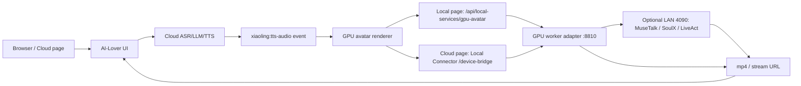

# GPU Digital Human Worker

AI-Lover 2.0.4 adds a pluggable GPU digital human path. The main app keeps Live2D as the CPU-safe default, and can route TTS audio to a local or LAN GPU worker for neural lip-sync/video generation.

## Recommended Architecture



## Runtime Modes

| Mode | Setting | Behavior |
| --- | --- | --- |
| Live2D / CPU | `显示模式 = Live2D / CPU` | Existing stable Live2D renderer. |
| Local GPU preview | `显示模式 = GPU 数字人`, `GPU worker = http://127.0.0.1:8810` | AI-Lover auto-starts the built-in worker adapter and shows a preview poster/lip placeholder. |
| LAN GPU backend | `GPU worker = http://192.168.x.x:port` | Browser sends the endpoint through Local Connector; the customer PC talks to the LAN GPU backend. |
| Direct local backend | Local browser, `GPU worker = http://192.168.x.x:port` | Next.js proxies `/api/gpu-avatar/*` to the private LAN endpoint. |

Cloud pages cannot directly reach a customer LAN address. For `https://ai.vituralmodel.com`, always enable Local Connector when using hardware or a LAN GPU backend.

## Worker API Contract

Any MuseTalk, SoulX-LiveAct, LivePortrait, or custom 4090 service should expose:

### `GET /health`

```json
{
  "ok": true,
  "provider": "soulsx-liveact",
  "tier": "upper-body",
  "streaming": false,
  "gpu": { "name": "NVIDIA RTX 4090", "memory": "24GB" },
  "avatars": [
    {
      "id": "default",
      "name": "Xingye",
      "posterUrl": "/assets/avatar.jpg"
    }
  ]
}
```

### `POST /render`

Request:

```json
{
  "avatarId": "default",
  "audio": "base64 encoded wav/mp3/pcm from AI-Lover TTS",
  "metadata": {
    "text": "你好",
    "mimeType": "audio/wav"
  },
  "output": "mp4"
}
```

Response:

```json
{
  "ok": true,
  "provider": "soulsx-liveact",
  "videoUrl": "/videos/job-001.mp4",
  "posterUrl": "/assets/avatar.jpg",
  "durationMs": 2200
}
```

For realtime services, return `streamUrl` instead of `videoUrl` if needed. AI-Lover accepts both.

## Built-in Adapter

The built-in adapter lives at:

```text
workers/gpu_avatar_worker/local_image_worker.js
```

It starts on:

```text
http://127.0.0.1:8810
```

Useful environment variables:

| Variable | Default | Meaning |
| --- | --- | --- |
| `GPU_AVATAR_WORKER_PORT` | `8810` | Local adapter port. |
| `GPU_AVATAR_BACKEND_URL` | empty | Optional real GPU backend URL. |
| `GPU_AVATAR_BACKEND_HEALTH_PATH` | `/health` | Backend health path. |
| `GPU_AVATAR_BACKEND_RENDER_PATH` | `/render` | Backend render path. |
| `GPU_AVATAR_RENDER_TIMEOUT_MS` | `180000` | Long render timeout for neural video. |
| `GPU_AVATAR_IMAGE_PATH` | bundled Xingye image | Poster/avatar fallback image. |

Example: connect a LAN 4090 worker directly from the adapter:

```powershell
$env:GPU_AVATAR_BACKEND_URL="http://192.168.110.50:7860"
node workers\gpu_avatar_worker\local_image_worker.js
```

## Model Guidance

- Start with MuseTalk-style head/upper-body lip-sync. This is the safest first milestone for RTX 4090 class hardware.
- SoulX-LiveAct full-body realtime is much heavier. Treat it as a separate LAN GPU backend and keep the AI-Lover contract above unchanged.
- FP4 paths mentioned in the handoff are mainly for newer architectures. RTX 4090 can test many pipelines, but full-body realtime quality and FPS must be measured.
- Keep ASR, LLM, TTS, subtitles, head, hand, and command-bus logic in AI-Lover. The GPU worker should focus only on audio-to-video/avatar rendering.
